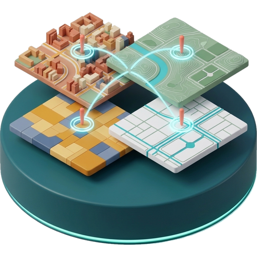

# 02Multimap: Synchronized Map Views

**Compare maps side by side in QGIS 3.40 LTR and QGIS 4: 2, 3, 4, 6 or 8 linked map panels, or a swipe view of two layer sets in one map.**

---

## Documentation

The [user manual](https://geophilo.com/zero2multimap/) describes every control and workflow.

## Why 02Multimap?

Planners, environmental scientists and demographers often compare spatial patterns: urban growth over the years, age groups or income levels, flood zones against landslide susceptibility, or planning scenarios. Toggling layers on and off in one map makes these comparisons slow and easy to misread.

02Multimap opens a separate window with up to eight map panels. Panning, zooming or rotating one panel moves the others, and a cursor marker shows the same place in the other panels. The Swipe layout puts two layer sets in one map and lets you drag a divider across it.

## Features

- **Panel grids**: 2 panels (side by side or stacked), 3, 4 (2x2), 6 (2x3) or 8 (2x4).
- **Swipe**: one map shows a bottom layer set everywhere and a top layer set on one side of a divider that you drag; the divider can stand upright or lie flat. The swipe map pans and zooms with the other maps like any panel.
- **Linked navigation**: panels share their centre, scale and rotation, converted between coordinate systems when panels use different CRSs. Navigation can also be linked to the main QGIS map.
- **Laser crosshair**: moving the mouse over one panel marks the same coordinate in the other panels, and on the main QGIS map when *Sync Canvas* is on. It is not shown in the Swipe layout, which is a single map.
- **Panel modes**: *Follow Main Map* (the layers of the main QGIS map), *Compare One Layer* (one layer per panel, over an optional shared background) and *Use Map Theme* (a QGIS map theme).
- **Choose for Me**: assigns a different layer to every panel, preferring layers that overlap the current map extent.
- **Templates and time series**: *Before & After*, *4-Scenario Matrix* and *Temporal Timeline* templates; time-series auto-fill sorts layers by the year in their names (for example `landuse_2015`) and reports what it assigned.
- **Multi-Inspect**: one click shows the attributes of the feature under the cursor, and raster values, in every panel.
- **Show Diff**: marks what was added (green) and removed (red) between the layers of panels 1 and 2, with an overlap figure.
- **True-area readouts**: feature counts and polygon areas per panel, measured on the ellipsoid, so the area is true ground area in any CRS.
- **Presets and projects**: save a panel setup as a preset; the setup is also stored in the QGIS project and restored when the project is opened.
- **Print layout**: title, panel headers, a north arrow, legend and scale bar on every panel, and a footer with a legend and scale bar. Export to PDF, PNG, JPEG or SVG, or open the layout in the QGIS Layout Designer to edit it.
- **Offline HTML dashboard**: one self-contained HTML file with the exact QGIS rendering of every panel, linked pan and zoom, north arrows, scale bars and legends, a linked cursor, distance measuring on the WGS 84 ellipsoid, three colour themes and a slide mode.
- **Swipe in exports**: the print layout, the Layout Designer and the HTML dashboard show a swipe as two maps side by side (bottom layers, top layers) at the swipe map's extent and scale.
- **QGIS 3.40 to 4.x**: uses `qgis.PyQt` for both PyQt5 and PyQt6 and has no dependencies outside QGIS.

## Installation

**From the QGIS Plugin Hub:** `Plugins → Manage and Install Plugins…` → search for **"02Multimap"** → *Install*.

**From a release zip:** download the latest zip from [Releases](https://github.com/YusufEminoglu/zero2multimap/releases) → `Plugins → Manage and Install Plugins… → Install from ZIP`.

Requires QGIS 3.40 or newer, including QGIS 4.x.

## Quick start

1. Add the layers you want to compare and zoom the main QGIS map to your study area.
2. Open 02Multimap from its toolbar icon or from `Plugins → 02Multimap`.
3. Choose a grid, for example **4 Panels (2x2)**, or **Swipe (bottom / top)**.
4. Click **Choose for Me**. The four panels switch to **Compare One Layer** and each receives a different layer.
5. Change any panel's layer from its list, then pan or zoom: all panels follow.
6. Use **Export / Print…** for a print layout (file or Layout Designer) or an offline HTML dashboard.

## Layout reference

| Layout | Arrangement | Typical use |
|--------|-------------|-------------|
| **2 Panels (1x2)** | 1 row x 2 columns | Before/after, suitability against existing use |
| **2 Panels (2x1)** | 2 rows x 1 column | Wide study areas, stacked comparisons |
| **3 Panels (1x3)** | 1 row x 3 columns | Past, present and future |
| **4 Panels (2x2)** | 2 rows x 2 columns | Four scenarios, demographic comparisons |
| **6 Panels (2x3)** | 2 rows x 3 columns | Multi-criteria evaluations, regional comparisons |
| **8 Panels (2x4)** | 2 rows x 4 columns | Long time series, many categories |
| **Swipe (bottom / top)** | One map, two layer sets | Change between two dates or two scenarios at full map size |

## Other plugins by the same author

| Planning and analysis | CAD and production | Visualization and display |
|---|---|---|
| [PlanX](https://github.com/YusufEminoglu/PlanX) — urban analytics: space syntax, centrality, morphology | [PlanX CAD Toolset](https://github.com/YusufEminoglu/PlanX-CAD) — drafting, measurement, road platforms | [3D City Studio](https://github.com/YusufEminoglu/planx_3d_city) — QGIS to Three.js city viewer |
| [GeoStats Lab](https://github.com/YusufEminoglu/planx_geostats) — spatial statistics, hotspots, LISA, regression | [EasyFillet](https://github.com/YusufEminoglu/EasyFillet) — CAD fillet and tangent arc | [3D OSM Model](https://github.com/YusufEminoglu/osm_3d_model) — OSM to a Three.js 3D city in the browser |
| [MCDA Suitability Lab](https://github.com/YusufEminoglu/planx_suitability_lab) — raster suitability analysis | [Settlement Planning Toolset](https://github.com/YusufEminoglu/PlanX-Settlement) — block to parcel settlement plans | [OSM Quick 3D](https://github.com/YusufEminoglu/osm_quick_3d) — OSM to native QGIS styling and 3D |
| [DataCube Lab](https://github.com/YusufEminoglu/planx_datacube) — space-time data cubes | [UIP Zoning Plan Toolset](https://github.com/YusufEminoglu/PlanX-UIP) — Turkish implementation plans | [Urban Procedural 3D Studio](https://github.com/YusufEminoglu/planx_urban_procedural_3d) — parametric 3D zoning |
| [Urban Resilience Lab](https://github.com/YusufEminoglu/planx_urban_resilience) — seismic, flood, heat and social vulnerability | [ParcelFlux](https://github.com/YusufEminoglu/parcelflux) — block to parcel subdivision | [02CartoLab](https://github.com/YusufEminoglu/zero2cartolab) — thematic maps and print layouts |
| [02Viz](https://github.com/YusufEminoglu/zero2viz) — chart studio (Python, R, HTML) | | [02Multimap](https://github.com/YusufEminoglu/zero2multimap) — synchronized map views |

## License and author

GPL-3.0-or-later © [Yusuf Eminoğlu](https://github.com/YusufEminoglu). Bug reports and feature requests are welcome in [Issues](https://github.com/YusufEminoglu/zero2multimap/issues).
