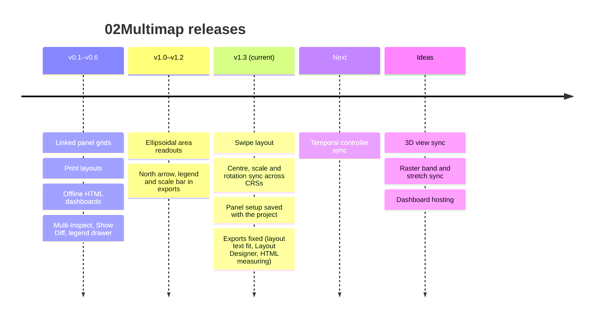

# Roadmap — 02Multimap

This document lists what 02Multimap does today and what may come next. Ideas move into a release when there is measured demand for them.

---

## Releases

---

## Current: 1.3

- **Swipe layout**: one map, a bottom layer set everywhere and a top layer set on one side of a draggable divider, upright or flat.
- **Sync that holds**: panels share centre, scale and rotation; the centre is converted between coordinate systems; resizing and grid changes do not move other maps.
- **Project and presets**: the panel setup is saved in the QGIS project; presets keep map themes and the scale.
- **Exports**: print layout text is fitted to its boxes, the layout can be opened in the Layout Designer, and the HTML dashboard measures distances on the WGS 84 ellipsoid.

See [CHANGELOG.md](CHANGELOG.md) for the full list.

---

## Next

### Temporal controller sync
- **Goal**: let each panel show a different time of the same temporal layer, driven by the QGIS temporal controller, for time-series comparison at a glance.
- **Approach**: give each panel canvas its own temporal range derived from the project's `QgsTemporalController`, offset per panel.

---

## Ideas without measured demand yet

### 3D view sync
- **Goal**: move QGIS 3D map views with the 2D panels.
- **Approach**: synchronise the camera target, pitch and yaw of open `Qgs3DMapCanvas` views with the active panel. Large; waiting for demand.

### Raster band and stretch sync
- **Goal**: link contrast stretch, band combination and min/max between panels (for example false colour against natural colour imagery).

### Dashboard hosting
- **Goal**: publish an HTML dashboard to the web in one step. The exported file already works offline and can be hosted anywhere as a static page.

---

## Contribution guidelines

When implementing features from this roadmap:
1. Keep compatibility with **QGIS 3.40 LTR** and **QGIS 4.x** (`qgis.PyQt`, scoped enums, no bare `Qt.*`).
2. Keep the plugin free of dependencies outside QGIS.
3. Add value-level tests to `tests/`: pure tests as `tests/test_*.py` (pytest) and QGIS tests as `tests/test_*_qgis.py`, run on both QGIS runtimes.
